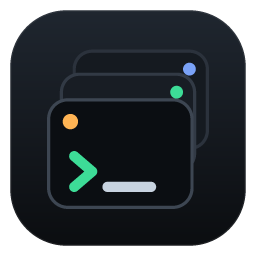
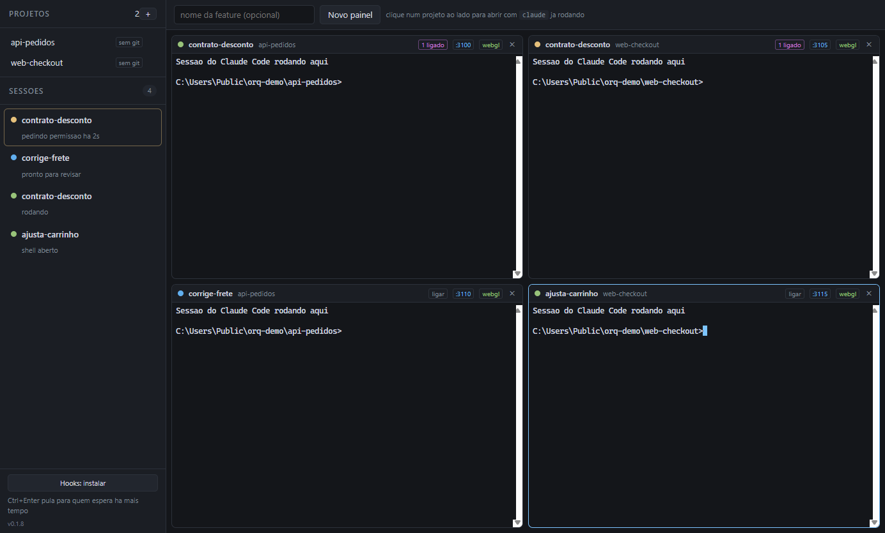

# Orquestrador de CLIs

**Todas as suas sessões do Claude Code numa tela só, e a que espera você sempre em destaque.**

<br clear="left">



Você abre cinco sessões, vai fazer outra coisa, e uma delas fica dez minutos parada pedindo permissão
sem ninguém ver. O Orquestrador resolve isso: cada sessão num painel, cada uma no próprio worktree, e
a que precisa de você acende.

## O que ele faz

| | | |
|---|---|---|
| **● Atenção primeiro**<br>A sessão que espera você fica âmbar em segundos, na lateral e no painel. Aprove o pedido sem entrar no terminal. | **⎇ Um worktree por sessão**<br>Cada feature isolada, com faixa de portas própria. Duas sessões nunca brigam pela porta 3000. | **↗ Do commit ao PR**<br>Commit, push, pull request, checks e merge no painel Git, sem sair do app. |
| **◎ Issues do Pronix Flow**<br>Abra uma sessão a partir da issue, já no branch certo e com a descrição na caixa do Claude. | **✎ Revisão e Resumo**<br>Um clique pede a revisão final; outro manda a devolutiva para quem pediu a issue. | **↻ Sobrevive ao reinício**<br>Painéis, ligações e as últimas 500 linhas de cada terminal voltam quando você reabre. |

---

## Instalar

### Windows

Na [página de releases](https://github.com/Rafadegolin/cli-orchestrator/releases/latest) há mais de um
arquivo, e **qual baixar depende do Controle Inteligente de Aplicativos (SAC)** — o recurso do
Windows 11 que bloqueia programa sem assinatura de uma CA reconhecida. Este app não é assinado.

| Se o SAC estiver... | Baixe | Como abrir |
|---|---|---|
| **ligado** | `Orquestrador-X.Y.Z-**sac**.zip` | Extraia e rode **`Orquestrador.cmd`** |
| desligado | `...-instalador.exe` | Um clique, com atalho no menu Iniciar e auto-atualização |

Para saber qual é o seu caso: **Segurança do Windows → Controle de aplicativo e navegador → Controle
inteligente de aplicativos**.

> **Por que existe um pacote só para isso.** Com o SAC ligado, o instalador e o zip portátil são os
> dois bloqueados — e não há conserto pelo lado do arquivo: desbloquear não adianta, e **nem
> compilar na sua própria máquina** (medido: o binário sai novo no mundo, e é a identidade dele que
> o SAC julga). O pacote `-sac` roda sobre o `electron.exe` **original**, que o Windows já conhece.
> Em troca, o processo aparece como `electron.exe`. Detalhes e as medições em
> [docs/instalacao-e-assinatura.md](docs/instalacao-e-assinatura.md).

Nesse pacote, para ter atalho no menu Iniciar — e o ícone certo ao **fixar na barra de tarefas** —
abra o app e use **Ctrl+K → Criar atalho no menu Iniciar**, e fixe a partir dele. Fixando o
executável direto, o Windows tira o ícone do próprio `electron.exe`.

### macOS (Apple Silicon)

Baixe o `Orquestrador-X.Y.Z-mac-arm64.zip`, extraia, e na **primeira** abertura clique no app com o
**botão direito → Abrir**, confirmando na caixa que aparece. Depois disso ele abre com duplo clique
como qualquer outro.

> Esse passo existe porque o app não é assinado, e o Gatekeeper recusa o duplo clique nesse caso.
> Diferente do SAC do Windows, aqui **existe saída** — é uma vez por máquina. Quem preferir a linha
> de comando: `xattr -dr com.apple.quarantine /caminho/Orquestrador.app`.

Duas coisas funcionam diferente ali, e o app avisa em cada uma: a **atualização** é baixada pelo
site em vez de aplicada sozinha, e o **medidor de uso** lê a credencial do Chaveiro, pedindo
autorização na primeira vez. O resto — hooks, worktrees, portas, ligações — é igual.

Na primeira vez, **F1** (ou **⌘+/** no Mac) abre o manual completo dentro do próprio app, e lá há
uma seção só sobre o que muda no macOS.

Requisitos: Windows 10/11 ou macOS em Apple Silicon, e o [Claude Code](https://claude.com/claude-code)
instalado e autenticado. Nenhum dos pacotes precisa de Node — ele só é necessário para rodar do
código-fonte.

### Ligue os hooks na primeira vez

No rodapé da barra lateral (e em **Configurações → Integrações**) há o interruptor **Hooks**. Ligá-lo registra no seu
`~/.claude/settings.json` os avisos que fazem as bolinhas mudarem sozinhas.

O app pergunta antes, faz backup do arquivo e preserva o que já estiver lá. Sem os hooks o app
funciona, mas os status ficam parados — e é justamente o status que faz a grade valer a pena.

---

## Usando

**Cadastre um projeto.** No ícone de pasta da seção PROJETOS, aponte a pasta do repositório e escolha
a faixa de portas dele. Fica salvo, e vale também para os worktrees desse projeto.

**Abra uma sessão.** O `+` ao lado do projeto (ou um clique nele) pergunta como abrir: **sessão nova**
numa worktree — digite o nome e a dica embaixo mostra o worktree e o branch reais —, **retomar uma
conversa** ou **só o terminal**, sem Claude.

**Veja tudo pela lateral.** Cada projeto lista as próprias sessões, com o branch embaixo do nome. A que
espera você acende em âmbar e diz há quanto tempo; PR, CI e "pronto para revisar" aparecem num selo na
linha. O `⋯` de cada sessão liga a outro repositório, copia o branch ou fecha o painel. **Ctrl+B**
recolhe a lateral para um trilho estreito.

**Atenda a fila.** `Ctrl+Enter` pula direto para a sessão que está esperando há mais tempo. Quando o
app não está em primeiro plano, você recebe notificação do sistema.

**Aprove sem entrar no terminal.** Quando o Claude pede permissão, a pergunta aparece no rodapé do
painel com **Aprovar** e **Ver**. Aprovar responde "1. Yes" ao pedido que está na tela — nunca "não
perguntar mais", e nunca às cegas: se o app não achar o pedido no terminal, ele não escreve nada.

**Feche o trabalho pelo painel Git.** `Ctrl+Shift+G`, o botão da barra de título ou o chip de branch
do painel abre, à direita, o git da sessão focada:

- **Alterações:** marque os arquivos, escreva a mensagem (ou **Gerar**, que pede ao Claude Code em
  segundo plano) e faça o commit — só os marcados entram.
- **Git e novo PR:** os commits à frente da base, o push e o formulário do pull request.
- **PR e CI:** os checks por nome, o log de quem falhou, **Pedir correção à sessão** e o merge.

Push e merge sempre perguntam antes, e nunca usam `--force`.

**Revisão e Resumo.** No cabeçalho de cada painel: **Revisão** cola na caixa do Claude o pedido de
revisar, commitar e subir (o texto é editável em Configurações); **Resumo** pede a devolutiva ao
solicitante e a manda como rascunho para a issue no Flow.

**Issues, Histórico e Configurações são páginas.** **Issues** (`Ctrl+Shift+I`) lista as issues do Flow
em tabela e abre a sessão na worktree certa. **Histórico** (`Ctrl+Shift+H`) mostra as conversas do
Claude Code de cada projeto, com o último resumo do agente e **retomar** com um clique, e as métricas
de tempo por feature. **Configurações** (`Ctrl+,`) reúne tudo que antes ficava espalhado pela paleta.

**Ache tudo com `Ctrl+K`.** A paleta pula para qualquer sessão, abre uma nova em qualquer projeto e
alcança todo comando, agrupado por assunto. A busca ignora acento.

**Retome o trabalho de ontem.** As worktrees sem sessão aberta aparecem dentro do projeto (a seta ao
lado dele), com **retomar**, o que impede arquivar cada uma e a **limpeza** em lote das que já foram
integradas.

**Ligue sessões de repositórios diferentes.** Uma feature que mexe no backend e no frontend: **Ligar a
outro repositório…** (no `⋯`) dá a cada sessão acesso ao código da outra. Ou use **Implementação
dupla**: escolha dois projetos, um branch para cada, e o app cria as duas worktrees e abre **uma**
sessão que enxerga as duas.

**Copie do terminal.** `Ctrl+C` copia quando há texto selecionado e continua interrompendo quando não
há; `Ctrl+Shift+C` copia sempre, `Ctrl+Shift+V` cola, e o botão direito abre Copiar / Colar /
Selecionar tudo.

**Feche sem medo.** O arranjo é salvo. Ao reabrir, os painéis voltam adormecidos, com a saída anterior
na tela e um botão de retomar.

### Ajuda dentro do app

**F1** (ou **⌘+/** no Mac), ou o botão **?** no rodapé da lateral. É o manual completo — cada
recurso, os atalhos, as portas, os hooks e uma seção de problemas comuns com sintoma e causa.

Os números que ela cita (portas, limites, caminho da pasta de dados) são lidos do app em execução, não
copiados à mão, então não envelhecem quando o código muda.

### Portas

Cada painel recebe **5 portas livres** a partir da 3100, exportadas como `PORT`, `ORQ_PORTA` e
`ORQ_PORTAS`. A porta aparece no cabeçalho do painel.

Para o seu projeto usá-las, ele precisa ler a variável:

| Stack | O que fazer |
|---|---|
| Next | `next dev` já respeita `PORT`. Se houver `-p 3001` fixo no script, ele vence a variável e precisa sair. |
| Vite | Ignora `PORT`. Use `vite --port %PORT%`, ou `server: { port: Number(process.env.PORT) \|\| 5173 }`. |
| Nest / Express | Garanta `app.listen(process.env.PORT ?? 3000)`. |
| Turborepo | Cada app pega uma posição de `ORQ_PORTAS`. |

### Arquivos que o worktree não leva

Um worktree é um checkout limpo: o `.env` não vai junto, e sem ele a aplicação não sobe. Quando o app
detecta essa situação, oferece criar um `.worktreeinclude` listando o que copiar.

---

## Atualizar

O app avisa quando sai versão nova, e o botão na lateral **aplica e reinicia** — inclusive nos
pacotes em zip, que não têm instalador. Ali ele baixa só o próprio código (~4 MB, não os 142 do
pacote), confere o SHA-256 e troca ao reiniciar. Você não precisa voltar ao GitHub.

A exceção é quando a versão nova muda algo além do nosso código — o Electron, por exemplo. Aí a troca
leve não serve, e o botão leva à página da release dizendo por quê.

Seus dados não ficam na pasta do app: projetos, sessão e configuração moram em `~/.orquestrador`, e
não se perdem ao substituir a pasta.

---

## Desenvolvimento

```bash
npm install
npx install-electron        # o Electron 43 nao baixa o binario sozinho
npm start                   # roda o app
npm run dev                 # roda com a porta de depuracao, para os testes
npm run empacotar           # gera instalador e zip portatil em dist/ (Windows)
npm run empacotar:sac       # o pacote que abre com o Smart App Control ligado
npm run empacotar:mac       # zip arm64 em dist/ (roda no proprio Mac)
```

Os testes dirigem o app de fora via CDP, sem instrumentar o código de produção. Suba com
`npm run dev` antes de rodar qualquer um — e **uma instância por vez**.

No macOS rodam `fase1`, `fase45`, `fase6`, `portas`, `worktrees`, `ajuda`, `terminal` e `arvore`. Os
demais medem CPU/RAM por WMI ou testam SAC e assinatura do Windows, e não têm correspondente lá.

```bash
npm run teste:fase1         # PTY, lote de IPC, resize, enxurrada
npm run teste:fase2         # grade, orcamento de WebGL, RAM e CPU
npm run teste:fase45        # hooks, bolinhas, ordenacao por urgencia
npm run teste:fase6         # painel fora da tela, fila de partida
npm run teste:fase7         # sessao salva, painel dormindo, retomar
npm run teste:projetos      # cadastro e comando inicial
npm run teste:terminal      # abrir terminal do projeto, sem o Claude
npm run teste:portas        # dois servidores no ar ao mesmo tempo
npm run teste:worktrees     # listar, recusar e arquivar
npm run teste:ajuda         # a ajuda, e se os numeros dela batem com o codigo
npm run teste:ligacoes      # mecanica das ligacoes
npm run teste:vistas        # trocar entre grade e paginas sem mexer no terminal
npm run teste:config-ui     # a pagina de Configuracoes
npm run teste:git-painel    # commit, PR, merge e Gerar, em Node puro
npm run teste:inspetor-ui   # o painel Git pela tela
npm run teste:transcritos   # o leitor das conversas do Claude Code
npm run teste:sac           # o pacote -sac abre e o terminal funciona
npm run diagnostico         # por que o Windows bloqueou o instalador
npm run perfil              # CPU e RAM por processo
```

- [`docs/orquestrador-clis-documentacao.md`](docs/orquestrador-clis-documentacao.md) — a
  especificação de construção, com as metas de performance e o raciocínio de cada decisão.
- [`docs/fase-9-extras.md`](docs/fase-9-extras.md) — o que ainda pode ser feito.
- [`docs/instalacao-e-assinatura.md`](docs/instalacao-e-assinatura.md) — o bloqueio do Windows,
  por que acontece e as opções.
- [`CLAUDE.md`](CLAUDE.md) — invariantes e armadilhas para quem for mexer no código.
